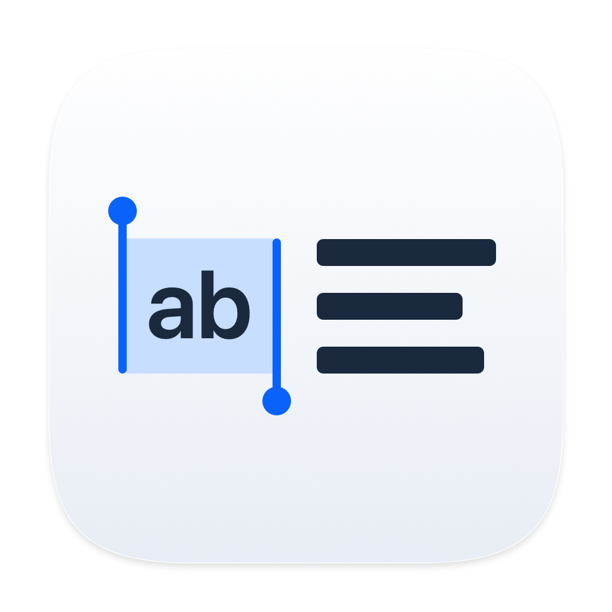
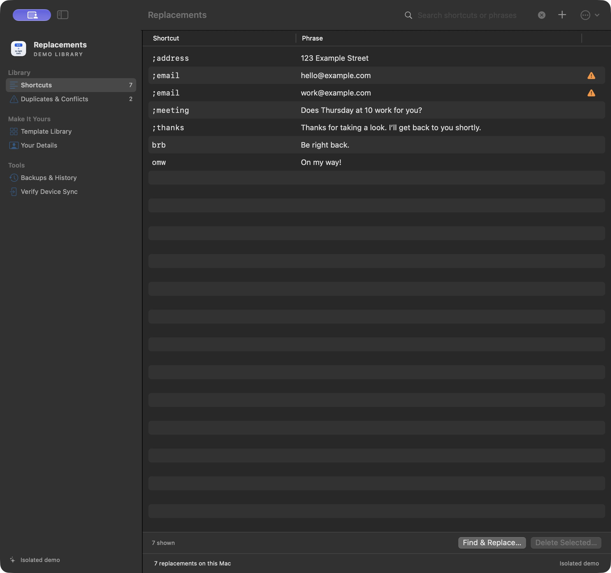
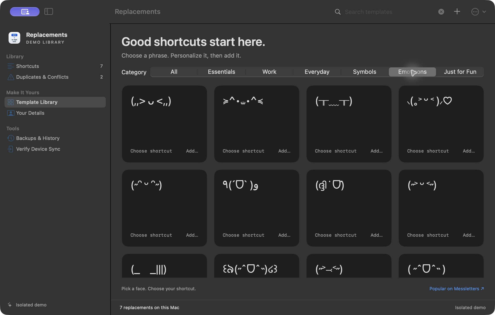

<p align="center"></p>
<h1 align="center">Replacements</h1>
<p align="center">A little less typing. A better home for Apple's text replacements.</p>
<p align="center"><a href="https://github.com/gjeffrey/Replacements/releases/tag/v0.3.5">Download for Mac</a> · <a href="docs/TEMPLATES.md">Template library</a> · <a href="CONTRIBUTING.md">Contribute</a></p>

A small, free, native macOS app for managing the shortcuts already built into your Mac, iPhone and iPad. No account, subscription, custom expansion engine or custom sync service. SwiftUI, AppKit where needed, with Sparkle for updates. MIT licensed; third-party notices are preserved.



## Your words, in one place

- **A compact reference.** Search your shortcuts, glance at their phrases, select an entry to preview and copy it, or edit it inline. Rows expand while editing.
- **259 useful templates.** Contact details, signatures, meeting links, replies, plain-text outlines, symbols and small bits of fun. Cards show phrase previews; opening a template helps you fill in your own information.
- **200 emoticons.** A static collection of Popular faces from Messletters plus a favorite. Preview a face, choose your own shortcut, then add it.
- **Remembered details.** Save details locally and reuse them across templates. Edit or forget them whenever you like. Sample gallery data never becomes your personal data.
- **Bulk tools with review.** Find/replace, multi-select deletion, JSON/CSV/Apple plist import/export, and duplicate/conflict detection.
- **Local history.** A snapshot before every mutation, with up to 50 backups and reviewed restoration.
- **Optional quick add.** Enable the menu-bar panel in Settings if you want it. It is off by default.



## Install

[Download Replacements 0.3.5](https://github.com/gjeffrey/Replacements/releases/download/v0.3.5/Replacements.zip), unzip it, and move Replacements.app to Applications. Quit an older copy before replacing it.

The release is a universal Apple Silicon/Intel build, signed with Developer ID, notarized by Apple and stapled. macOS 15 or later. This is an early release: native integration and user-observed phone sync have been checked on macOS 27.0.1 on Apple Silicon; Intel runtime and the full supported-OS range still need testing.

## Updates

Check for Updates… is in the Replacements app menu and Settings. Automatic checks can be disabled in Settings. Update downloads come from GitHub releases and are verified by Sparkle; installation requires your choice and waits for pending edits/saves. Install 0.3.1 manually once if you have an earlier version. [Release/update instructions](docs/UPDATES.md).

## Build and try

Requires macOS and Swift 6 or later. Xcode or Command Line Tools work. Open `Package.swift` in Xcode, or:

```sh
./scripts/test.sh
./scripts/build-app.sh
open ../Replacements.app
```

For isolated sample data:

```sh
open -n ../Replacements.app --args --demo
```

Demo replacements stay in memory; its local profile and history use a separate `Replacements-Demo` directory. Quit before switching modes. If Xcode test signing encounters Finder metadata in a synced working folder, use a temporary build directory:

```sh
REPLACEMENTS_TEST_BUILD_DIR="$(mktemp -d)" ./scripts/test.sh
```

## How it works

Writes go through Apple's private **KeyboardServices** framework. When native querying is incomplete, the app uses a **read-only SQLite fallback**. It never writes directly to the database, rewrites global defaults, kills Apple's daemon, automates System Settings, or accesses your Apple Account.

Changes enter Apple's own library, so Apple handles device sync. Creation, editing and deletion were observed on the developer's phone during the guided test. There is also a **Verify Device Sync** view for checking your own devices.

KeyboardServices is private and unsupported. Future macOS updates may change it; this app is independent of Apple. Runtime selector/schema checks disable writes when native access is unsupported. A local success does not guarantee delivery to every device. [Integration and validation details](docs/VALIDATION.md).

New entries require a shortcut on macOS. Existing word-only entries from iPhone/iPad remain visible and exportable; edit those on the device. Current Mac KeyboardServices rejects writes without a shortcut, so the app rejects unsupported changes before any batch writes.

Before a change, the app validates the reviewed baseline and plan and saves a backup. It verifies writes, stops a batch on failure, and never automatically resends an ambiguous operation. Bulk changes are not atomic; Refresh and History let you inspect and recover a partial result. [Recovery and sync notes](docs/DEVICE-SYNC.md).

## Local data

Profiles and backups live in `~/Library/Application Support/Replacements`, with private file permissions. They are not included in this repository, exported as a profile, or sent to a custom service. Only phrases you add enter Apple's native library. Changing remembered details fills future templates; it doesn't silently rewrite existing replacements.

## Contribute

Useful native-compatible templates, accessibility improvements and macOS compatibility reports are welcome. [Contribution guide](CONTRIBUTING.md) · [Issues](https://github.com/gjeffrey/Replacements/issues) · [Changelog](CHANGELOG.md).

[MIT license](LICENSE). Original code and artwork; [reference acknowledgements](Resources/Acknowledgements.md), [template inspiration](docs/TEMPLATES.md), [icon design and rendering](docs/ICON-v035.md), and [signed distribution](docs/DISTRIBUTION.md). No AGPL or unlicensed source was incorporated.
